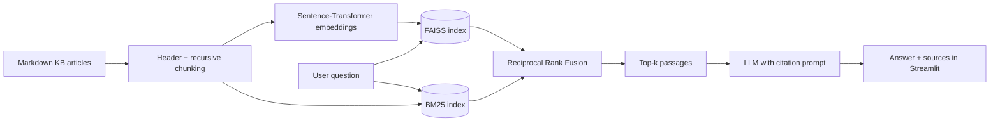

# IT Helpdesk Assistant (RAG)

A chatbot that answers employee IT questions (VPN, passwords, MFA, Outlook, printers, BitLocker, phishing and more) using **Retrieval-Augmented Generation**. Every answer is grounded in an internal knowledge base and cites its sources. If the answer is not in the knowledge base, the bot says so instead of guessing.

**Stack:** Python · LangChain · FAISS · BM25 · Sentence-Transformers · Ollama / Groq / OpenAI · Streamlit

## Features

- **Hybrid retrieval**: semantic search (FAISS + sentence-transformer embeddings) combined with keyword search (BM25), merged with **Reciprocal Rank Fusion**.
- **Heading-aware chunking**: Markdown articles are split by section first, then into overlapping chunks, and each chunk keeps its `Title > Section` path for context.
- **Cited, grounded answers**: the LLM must cite passages like `[1][2]`; the UI shows which sources were used.
- **Hallucination guard**: out-of-scope questions get a fixed "not in the knowledge base" reply.
- **Swappable LLM**: local Ollama (free), Groq (free API tier), OpenAI, or retrieval-only mode.
- **Evaluation suite**: 48 labeled questions measure Hit@k and MRR for each retrieval mode, plus citation and refusal accuracy for the LLM.
- **Streamlit chat UI** with streaming answers, source viewer, and retrieval settings.

## Architecture



## Project structure

```
it-helpdesk-rag/
├── app.py                # Streamlit chat UI
├── data/kb/              # 14 IT knowledge base articles (Markdown)
├── src/
│   ├── config.py         # settings (env-overridable)
│   ├── ingest.py         # load -> chunk -> embed -> save FAISS + chunks
│   ├── retrieval.py      # dense, BM25 and hybrid (RRF) retrieval
│   ├── llm.py            # Ollama / Groq / OpenAI factory
│   ├── rag.py            # prompt + chain + citations
│   ├── utils.py          # RRF, tokenizer, citation parsing
│   └── metrics.py        # Hit@k, MRR
├── eval/
│   ├── questions.json    # 43 in-scope + 5 out-of-scope labeled questions
│   └── evaluate.py       # retrieval + LLM evaluation
└── tests/test_core.py    # unit tests
```

## Setup

**1. Create a virtual environment and install packages** (Python 3.10+)

```bash
python -m venv .venv
# Windows
.venv\Scripts\activate
# macOS / Linux
source .venv/bin/activate

pip install -r requirements.txt
```

**2. Choose an LLM**

```bash
cp .env.example .env      # Windows: copy .env.example .env
```

- **Ollama (free, local, default):** install from [ollama.com](https://ollama.com), then run `ollama pull llama3.2`.
- **Groq (free API, fastest setup on a low-RAM laptop):** get a key at [console.groq.com](https://console.groq.com), then in `.env` set `LLM_PROVIDER=groq` and `GROQ_API_KEY=...`.

**3. Build the index** (downloads the ~90 MB embedding model the first time)

```bash
python -m src.ingest
```

**4. Run the app**

```bash
streamlit run app.py
```

Open http://localhost:8501 and ask something like *"My VPN says authentication failed"*.

You can also query from the terminal:

```bash
python -m src.rag "How do I get my BitLocker recovery key?"
```

## Evaluation

```bash
python -m eval.evaluate          # retrieval: Hit@1/3/5 and MRR@5 for dense, BM25, hybrid
python -m eval.evaluate --llm    # + citation rate, source accuracy, refusal accuracy
pytest                           # unit tests
```

Results are saved to `eval/results.json`. Paste your numbers here after running:

| Mode | Hit@1 | Hit@3 | Hit@5 | MRR@5 |
|---|---|---|---|---|
| dense | | | | |
| bm25 | | | | |
| hybrid | | | | |

**Ideas to improve the scores:** try `EMBEDDING_MODEL=BAAI/bge-small-en-v1.5`, tune `CHUNK_SIZE`, add a cross-encoder re-ranker, or add more labeled questions.

## Using your own documents

Drop `.md` files into `data/kb/` (use `#` for the title and `##` for sections), then re-run `python -m src.ingest` or click **Rebuild index** in the app.

## Possible extensions

- Conversation memory with follow-up question rewriting
- Cross-encoder re-ranking (e.g. `cross-encoder/ms-marco-MiniLM-L-6-v2`)
- PDF and Confluence/SharePoint loaders
- A FastAPI endpoint and Docker image
- Auto-create a support ticket when the bot cannot answer
